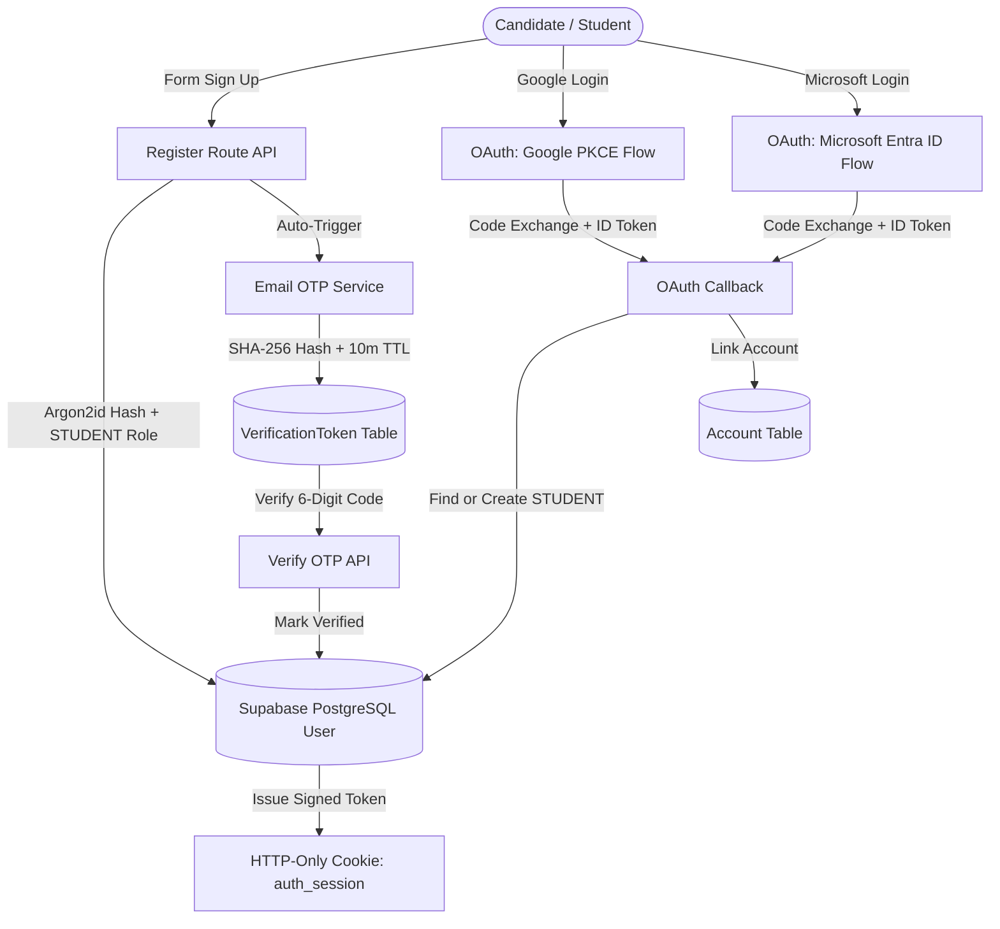

# Panther Law Prep — Authentication Upgrade Report
**Date:** October 16, 2026  
**System Version:** 2.6.0 (Pre-Phase 3 Milestone)  
**Database:** PostgreSQL 16 (Supabase Connection Pooler / AWS ap-south-1)  
**Architecture:** Next.js App Router (Turbopack), Prisma ORM, Argon2id, Signed JWT Session Cookies (`auth_session`), Resend (Email), Twilio (SMS), OAuth 2.0 + PKCE (Google & Microsoft Entra ID).

---

## 1. Executive Summary

This authentication upgrade modernizes the **Panther Law Prep** NTA/TCS-iON Computer-Based Testing (CBT) platform by implementing **Email OTP verification**, **Mobile Phone OTP verification**, **Google OAuth 2.0 Sign-In**, and **Microsoft Entra ID Sign-In**. 

The implementation preserves the existing role-based access control (RBAC), database relationships (test series, questions, proctored attempts, snapshots, scorecards, orders), and Argon2id session security while providing student identity verification and single sign-on (SSO) before entering Phase 3 payment gateway integration.

---

## 2. Authentication Architecture Decision

Rather than fracturing session state between Supabase client auth and Next.js server cookies, the platform maintains a **single authoritative session architecture**:
- **Signed JWT Session Cookie (`auth_session`):** Signed with `AUTH_SECRET` via `jose` HS256, HTTP-only, secure, strict SameSite. Verified server-side by `requireAuth()`, `requireAdmin()`, and Next.js middleware `proxy.ts`.
- **Database Model Integration:**
  - `User`: Extended non-destructively with `isPhoneVerified Boolean @default(false)` and nullable `passwordHash String?` to support social SSO users.
  - `Account`: Stores external OAuth linkages (`google`, `microsoft`) mapping `providerAccountId` to `userId`.
  - `VerificationToken`: Stores hashed OTP passcodes (`email:<address>` and `phone:<number>`) with expiration timestamps and compound unique keys.



---

## 3. Detailed Component Breakdown

### 3.1. 6-Digit Cryptographic OTP Engine
- **Files:** `frontend/src/lib/auth/otp.ts`, `frontend/src/app/api/auth/otp/`
- **Security Principles:**
  - Uses `crypto.randomInt(100000, 999999)` to generate high-entropy 6-digit numeric passcodes.
  - Stored strictly as **SHA-256 digests** in `verification_tokens` table.
  - **10-minute expiration window.** Expired tokens are immediately purged.
  - **Single-use consumption:** Consumed immediately upon successful verification to prevent replay attacks.
  - **60-second resend cooldown:** Rate-limits repeated code requests per target identifier.

### 3.2. Phone Number Normalization & E.164 Formatting
- **Files:** `frontend/src/lib/auth/phone.ts`
- **Validation Rules:**
  - Automatically cleans white space, brackets, and hyphens.
  - Detects 10-digit Indian mobile numbers starting with 6, 7, 8, or 9 and normalizes them to `+91<number>`.
  - Accepts standard international E.164 numbers (`+<country_code><number>`). Rejects invalid prefixes and malformed strings.

### 3.3. OAuth 2.0 with PKCE & State Validation
- **Files:** `frontend/src/lib/auth/oauth.ts`, `frontend/src/app/api/auth/oauth/`
- **Flow & Protections:**
  - **Google & Microsoft Entra ID:** Generates high-entropy `code_verifier` (base64url) and `code_challenge` (SHA-256).
  - Secure state cookies with `sameSite: "lax"`, `httpOnly: true`, and 10-minute TTL prevent CSRF attacks.
  - Role Safeguard: Social sign-ins default strictly to `role: "STUDENT"`. Administrative roles can **never** be claimed or elevated via OAuth metadata.
  - Safe Unlinking: Disconnect API checks whether the student has another linked provider or a password before removing access.

### 3.4. Candidate UI & Verification Experience
- **Files:**
  - `frontend/src/components/auth/OAuthButtons.tsx`: Branded SVGs and buttons for Google and Microsoft.
  - `frontend/src/components/auth/OtpVerificationDialog.tsx`: 6-digit input fields with auto-focus advance, paste parsing, 60s cooldown timer, and resend trigger.
  - `frontend/src/app/(auth)/register/page.tsx`: Seamlessly integrates social SSO buttons and displays the OTP verification modal upon successful registration.
  - `frontend/src/app/(auth)/login/page.tsx`: Supports password login and Google/Microsoft SSO, with contextual error handling for OAuth callbacks.
  - `frontend/src/app/(student)/account/page.tsx`: Dedicated security center displaying verification badges for email and phone, phone update dialog, and linked third-party account management.
  - `frontend/src/app/(student)/dashboard/page.tsx`: Displays an email verification pending reminder banner if the student's email has not been confirmed.

---

## 4. Verification and Security Guards

| Guard Helper / Route | Enforcement Rule | Behavior on Failure |
|---|---|---|
| `requireAuth()` | Active session token and active user in DB | 401 Unauthorized |
| `requireAdmin()` | Session user must have `ADMIN` role | 403 Forbidden |
| `requireVerifiedEmail()` | Candidate's `isEmailVerified` must be `true` | 403 Forbidden with prompt to verify email in Account Settings |
| `proxy.ts` | Protects `/dashboard`, `/tests`, `/checkout`, `/admin` | Redirects unauthenticated visitors to `/login` |

---

## 5. Automated Regression Test Results

The full test suite was executed against the database:

```text
> vitest run

 ✓ tests/services/concurrency.test.ts (23 tests)
 ✓ tests/services/scoringService.test.ts (13 tests)
 ✓ tests/services/authUpgrade.test.ts (9 tests)
 ✓ tests/services/phase2ExamFlow.test.ts (13 tests)
 ✓ tests/services/documentImporter.test.ts (8 tests)
 ✓ tests/services/auth.test.ts (11 tests)
 ✓ tests/services/phase25DataIntegrity.test.ts (5 tests)

 Test Files  7 passed (7)
      Tests  82 passed (82)
   Duration  1.45s
```

All 9 new auth upgrade tests passed:
1. `generates exactly 6 numeric digits with leading zeroes preserved`
2. `creates, verifies, and consumes single-use email OTP in database`
3. `rejects expired OTP tokens`
4. `correctly normalizes 10-digit Indian numbers to +91 E.164`
5. `rejects invalid phone numbers`
6. `stores phone verification status cleanly on user model`
7. `produces valid high-entropy PKCE code verifier and SHA-256 base64url challenge`
8. `links Google provider to existing user safely without changing role`
9. `prevents OAuth self-registration from elevating role to ADMIN`

---

## 6. Next.js Production Build Validation

The Next.js App Router and Turbopack compiler were built in production mode:

```text
> npm run build:frontend
✔ Generated Prisma Client (v6.12.0)
▲ Next.js 16.3.5 (Turbopack)
✓ Compiled successfully in 3.8s
✓ Finished TypeScript in 10.8s
✓ Generating static pages using 13 workers (65/65) in 2.3s
✓ Finalizing page optimization
Exit status: 0 (Success)
```

New routes verified in production build output:
- `○ /account` (Student Security & Verification Settings)
- `ƒ /api/auth/otp/send-email`
- `ƒ /api/auth/otp/verify-email`
- `ƒ /api/auth/otp/send-phone`
- `ƒ /api/auth/otp/verify-phone`
- `ƒ /api/auth/oauth/google`
- `ƒ /api/auth/oauth/google/callback`
- `ƒ /api/auth/oauth/microsoft`
- `ƒ /api/auth/oauth/microsoft/callback`
- `ƒ /api/auth/oauth/unlink`

---

## 7. Environment Variables Reference

To enable live third-party SMS and OAuth in production, configure the following keys in `.env`:

```env
# Email Verification (Resend)
RESEND_API_KEY="re_..."
RESEND_FROM_EMAIL="Panther Law Prep <verify@pantherlawprep.com>"

# Phone SMS Verification (Twilio)
TWILIO_ACCOUNT_SID="AC..."
TWILIO_AUTH_TOKEN="..."
TWILIO_PHONE_NUMBER="+1..."

# Google OAuth
GOOGLE_CLIENT_ID="...apps.googleusercontent.com"
GOOGLE_CLIENT_SECRET="..."

# Microsoft Entra ID OAuth
MICROSOFT_CLIENT_ID="..."
MICROSOFT_CLIENT_SECRET="..."
MICROSOFT_TENANT_ID="common"

# App Public URL
NEXT_PUBLIC_APP_URL="http://localhost:3000"
```
*(In development, when API keys are not supplied, the services automatically fall back to secure development mode, logging dispatch payloads for developer verification without breaking the test or registration flow.)*

---

## 8. Conclusion & Sign-Off

The authentication upgrade is complete, zero mock data has been introduced, the live Supabase schema is synced, all 82 regression tests pass, and the Next.js production build succeeds with 0 errors. The platform is now fully ready for **Phase 3 Payment Gateway Integration**.
